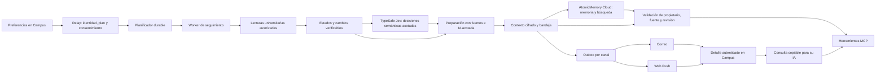

# Plan de implementación: Campu proactivo, fase 1

Fecha: 5 de noviembre de 2026 · Estado: plan preparado; funcionalidad aún no implementada.

Worktree: `/Users/USER/.codex/worktrees/campu-proactivo-fase-1/blackboard-cli`.
Rama: `codex/campu-proactivo-fase-1`. Base: `origin/main`, revisión `91864f0c` al crear el worktree.

## 1. Resultado que queremos entregar

El estudiante activa el seguimiento una vez. Campu revisa las fuentes universitarias autorizadas sin que tenga abierta su IA, prepara su semana, detecta novedades y avisa por los canales elegidos. Cada aviso permite consultar la evidencia y copiar una consulta para continuar desde su IA mediante Campus MCP.

La unidad de valor es una novedad o una semana preparada: qué ocurre, qué está confirmado, por qué podría requerir atención y qué información está lista para trabajar. El estudiante no tiene que mantener un diario ni invitar a su equipo para obtener valor.

Ejemplo ilustrativo:

> Ya revisé tu semana. Hay dos entregas publicadas y un avance programado en el sílabo que todavía no tiene tarea publicada. Reuní las indicaciones y los materiales disponibles. Ver mi semana · Preparar el avance con mi IA.

## 2. Alcance y decisiones iniciales

| Tema | Decisión propuesta para implementar |
| --- | --- |
| Lanzamiento | Piloto de 10–20 cuentas UPC elegibles, con activación expresa; infraestructura preparada para adaptadores por universidad. |
| Acceso | Capacidad `proactiveEnabled` resuelta por el plan central del relay y la lista del piloto. Nunca inferir acceso a partir de una etiqueta visual de Plus. |
| Fuentes académicas | Cursos activos, tareas, fechas, notas/retroalimentación, anuncios, árbol de contenidos y documentos pertinentes de Blackboard. |
| Trámites | Seguimiento opcional de solicitudes en las dos bandejas existentes de Mi UPC, dentro de este piloto. Sin acceder a portales externos nuevos. |
| UPN | Mostrar solo capacidades realmente validadas para esa conexión. La ampliación del piloto a UPN tiene su propia validación; no sustituir códigos ni herramientas UPC. |
| Experiencia web | Una bandeja «De Campu», detalle semanal y preferencias; acceso desde Campu y Mi perfil, sin añadir otra pestaña obligatoria a la navegación móvil. |
| Canales | Correo, Web Push o ambos por elección del estudiante. Bandeja disponible aunque ambos canales estén apagados. |
| IA | Código para reglas y diferencias exactas; TypeSafe/Jev para juicios semánticos tipados; Luna para síntesis y texto. Usar los US$40 de créditos de IA reportados por el usuario mediante la ruta de facturación que realmente los admita. |
| Memoria gestionada | AtomicMemory Cloud Pro como proveedor previsto de memoria, extracción compatible y recuperación de contexto, aprovechando el año ganado. Conservar hechos oficiales y estado operativo en Vault/PostgreSQL. |
| Herramientas gestionadas | Incorporar Qatom al hito de integración para aprovechar siete meses Max y el voucher individual Pro de doce meses. Validar alcance y autorización antes de servir contexto privado; no atribuirle funciones no documentadas. |
| Continuidad | Contexto persistente y herramientas de lectura en el relay MCP. Copiar consulta es el mecanismo compatible mínimo. |
| Fuera de alcance | Gestión de equipos, calendarios compartidos, diario obligatorio, mensajes a compañeros, pagos, reservas, creación de trámites y envíos académicos. |

## 3. Qué existe y qué falta

La inspección incluyó el checkout original de `blackboard-cli` y los checkouts locales de `campus-cli-internal` y `campus-profes`. Estos últimos contienen cambios ajenos sin confirmar; las capacidades observadas no acreditan su despliegue. El nuevo worktree no incorpora esos cambios automáticamente.

| Base observada | Uso en la fase 1 |
| --- | --- |
| `blackboard-cli/site/public/sw.js` y `site.webmanifest` | Mantener el shell sin conexión; añadir suscripción, recepción y apertura de Web Push. Actualmente no hay handlers de push. |
| `site/src/scripts/materials-handoff.ts` y `/app/copilot/` | Reutilizar la experiencia de consulta copiable y la limpieza al cambiar de cuenta; hoy depende de una conversación, así que necesita una referencia de contexto proactivo. |
| `site/src/scripts/mcp-handoff.ts` en la base del worktree | Es atribución analítica, no autorización ni transporte de contenido académico. No reutilizarlo como credencial. |
| `campus-cli-internal/src/cloud/week-dashboard.ts` | Reutilizar normalización cuando sirva, no su resultado como inventario exhaustivo: revisa hasta cinco cursos y recorta entregas. |
| `course-research-cache.ts`, `research-sessions.ts`, `blackboard-tree-scan.ts` | Extracción, evidencia y paginación existentes. Sus estados son temporales en memoria; no sirven como almacenamiento semanal durable. |
| `material-read-coordinator.ts` y `outbound-limit.ts` | Mantener coordinación y límites universitarios compartidos con las consultas interactivas. El límite observado es cuatro peticiones simultáneas por estudiante. |
| `vault-storage.ts`, `vault-service.ts`, `vault-service-client.ts` | Reutilizar mecanismos de cifrado y vinculación a cuenta/conexión mediante interfaces específicas para proactividad; no guardar todo como artefactos Class sin ciclo de vida propio. |
| Colas BullMQ/Redis de Class | Reutilizar infraestructura y patrones de leases/reintentos en colas nuevas; no mezclar trabajos con transcripción. |
| `campus-profes/src/app/auth.ts`, `campus-account.ts`, `blackboard-connection.ts` | Sesión web y vínculo comprobado con `campus_account_id`; puente de servidor hacia el relay. |
| `turnitin-notifications.ts`, `plus-notifications.ts`, `notification-environment.ts` | Patrones de outbox, claves estables y protección del correo local. Preferencias de correcciones existentes siguen siendo independientes. |

## 4. Arquitectura y responsabilidades

- **Relay / backend interno:** propietario de configuración canónica, programación, presupuesto, lecturas universitarias, estados, eventos y contexto. Ejecutar el worker con el runtime compartido del relay y una identidad de servicio limitada; nunca con tokens OAuth personales almacenados en la cola.
- **`campus-profes`:** fachada autenticada para la web. Resuelve la cuenta en servidor y llama al relay mediante puente privado con operaciones limitadas. No introduce una segunda fuente de verdad para las preferencias.
- **Sitio/PWA:** activación, bandeja, detalle, preferencias, push y continuidad hacia la IA.
- **Vault/PostgreSQL:** contenido cifrado y control durable con transacciones. **Redis:** referencias de trabajos, no documentos, cookies, correos ni notas.
- **AtomicMemory Cloud:** proveedor de memoria gestionada para contexto derivado y recuperable, detrás de una interfaz del relay. La salida se contrasta con el propietario y las revisiones canónicas antes de entregarla al MCP.
- **TypeSafe/Jev:** aporta decisiones semánticas tipadas y probabilidades; código del relay compone resultados y mantiene las reglas, permisos y ejecución.
- **Luna:** redacta el resumen y la consulta preparada con las fuentes seleccionadas, y atiende interpretaciones que requieran generación de texto o razonamiento adicional. Sus créditos y costos se contabilizan aparte de TypeSafe y AtomicMemory.
- **Qatom:** integración gestionada de herramientas, comenzando por una prueba privada con información sintética y sin cobros por llamada. Su uso con cuentas reales depende de verificar delegación de identidad, límites y tratamiento de datos.
- **Worker de entrega:** consume la outbox y ejecuta envíos. Antes de cada envío vuelve a comprobar canal, cuenta, acceso, revisión de consentimiento y antigüedad del aviso.

El seguimiento funciona fuera del proceso del navegador y no requiere mantener abierto un cliente MCP. No se construye un fallback local de consultas.

### 4.1. Usar los premios para reducir costo y trabajo

Decisión del usuario: aprovechar las herramientas ganadas al diseñar e implementar la primera fase, con adaptadores que permitan conservar el producto al terminar las bonificaciones.

| Recurso anunciado para el segundo puesto | Aplicación en Campu | Qué queda por verificar al canjear |
| --- | --- | --- |
| AtomicMemory Cloud Pro, un año, valor anunciado US$228 | Memoria y búsqueda de contexto; extracción/inferencia de memoria incluida según el plan público vigente. Evitar construir otra capa vectorial o repetir extracción compatible. | Cuenta beneficiaria, inicio/vencimiento, cuota efectiva, condiciones del premio, operaciones consumidas por cada flujo y capacidad de exportar/borrar. |
| Qatom Max para el equipo, siete meses, valor anunciado US$2.100 | Probar catálogo privado y llamada de capacidades ya implementadas en Campus. Evaluar si reduce integración/distribución de herramientas sin duplicar el relay. | Canje del premio específico, límites efectivos, identidad por estudiante, costos externos e inferencia realmente incluida, si existiera. |
| Voucher Qatom Pro individual, transferible, doce meses, valor anunciado US$240 por integrante | Reservar su uso para continuidad o un entorno compatible, conforme a condiciones de canje. | Transferibilidad no demuestra acumulación, prórroga de Max, conversión de planes ni activación diferida. No asumir 19 meses consecutivos ni sumar vouchers de terceros. |
| Créditos de IA reportados por el usuario, US$40 | Presupuesto inicial para Luna en preparación y redacción, con uso incremental y reutilización de resultados. | Proveedor/cuenta de facturación, saldo disponible, vencimiento, modelos y endpoint elegibles. No se ha consultado ni gastado ese saldo en esta planificación. |

La suscripción bonificada no equivale a dinero disponible para cualquier infraestructura. Registrar fechas reales de activación y vencimiento; no suponer que el plazo empezó al ganar el evento. No activar ofertas comerciales genéricas como sustituto del canje del premio.

**AtomicMemory como proveedor previsto del contexto:**

- Crear un adaptador `ProactiveMemoryProvider` con operaciones de ingesta, búsqueda, retirada y comprobación de disponibilidad. Usar SDK/API oficial con versión fijada al implementar.
- Separar desarrollo y piloto; si se usan proyectos adicionales, comprobar cómo comparten el cupo del plan.
- Ingestar contexto mínimo y referencias, nunca cookies, grants SSO o tokens de notificación. Informar del procesamiento externo al activar el seguimiento y respetar sus controles.
- Derivar el sujeto de memoria de la cuenta autenticada en servidor, con identificador opaco. No permitir que el modelo elija `user`, `thread`, `agent` o `namespace`. La documentación Cloud v1 no garantiza aislamiento simétrico por namespace y un thread explícito puede reemplazar el sujeto.
- Conservar procedencia, revisión, período y hash de fuente; comprobarlos al recuperar. La consolidación de memoria no puede cambiar fechas, puntajes ni evidencias oficiales.
- La inferencia incluida aplica a operaciones de memoria. No asumir que cubre generación semanal arbitraria, OCR, modelos externos, lecturas universitarias, hosting, colas, correo o push.
- El plan público Pro consultado anuncia 250.000 operaciones de memoria al mes y aproximaciones alternativas de documentos/búsquedas; no sumar esas cifras como bolsas independientes. Verificar el cupo del premio y medir consumo real en el piloto.
- Sincronizar desde el registro canónico con jobs idempotentes. Un fallo, reinicio de datos beta o agotamiento de cupo se resuelve con contexto canónico marcado apropiadamente y posterior reconstrucción del índice, dentro del relay.
- Usar bajas/tombstones locales para impedir la recuperación de contenido revocado incluso cuando el borrado externo esté pendiente. Probar purga, exportación y reconstrucción antes de subir datos del piloto.

**Qatom como integración gestionada de herramientas:**

- La documentación consultada permite catálogo privado, esquema de entrada y endpoint HTTPS alojado por el proveedor del servicio, con precio cero para una herramienta gratuita. No demuestra que Qatom ejecute nuestro worker, programe revisiones o cubra sus tokens de IA.
- Probar una sola capacidad de contexto con fixtures sintéticas y sin compras/pagos. No registrar herramientas académicas mutables ni crear un catálogo público con datos de estudiantes.
- Antes de usarla con cuentas reales, verificar cómo mantener la autorización por estudiante de Campus en cada llamada. Un token de servicio compartido o un `contextId` no sustituyen esa autorización. Si no se demuestra, mantener esa ruta fuera del tráfico privado y usarla únicamente para capacidades sin datos personales.
- La implementación y las lecturas universitarias permanecen en Campus/relay. Evitar construir un catálogo duplicado de todas las herramientas o condicionar el lanzamiento a una integración sin beneficio medido.
- Modelar límites distintos de Max y Pro. El Pro público consultado anuncia 250 transacciones al mes; no presupuestar la frecuencia del seguimiento sobre Max ilimitado si después tendría que pasar por Pro.

**Salida verificable del hito de proveedores:** inventario de premios efectivamente canjeados, matriz de capacidades probadas, cuotas y costos separados, prueba de aislamiento/purga y recorrido de una consulta sintética. El ahorro se mide contra servicios y trabajo que realmente evitamos, no contra el valor publicitario completo de los premios.

## 5. Activación, frecuencia y estados visibles

1. El estudiante abre «Campu proactivo». La pantalla verifica cuenta, capacidad del plan, universidad y conexión disponible.
2. Ve qué fuentes se revisarán y elige cursos/categorías y canales. Ningún permiso de notificaciones se solicita al cargar la página.
3. Activa el seguimiento. Se inicia una sincronización de referencia y se muestran avances/cobertura. Los datos anteriores no se anuncian como novedades.
4. Al terminar se ofrece una primera vista semanal, incluso si es parcial; como máximo un aviso de bienvenida al contexto preparado.
5. El resumen semanal y las novedades posteriores usan esa referencia. Pausar o desactivar actualiza la programación y cancela lo pendiente.

Valores iniciales del piloto, editables y sujetos a medición:

- Zona horaria `America/Lima`, guardada como zona IANA, no como desplazamiento fijo.
- Revisión de tareas, notas y anuncios a las 08:00, 12:00, 16:00 y 20:00, con dispersión de ejecución entre cuentas. Revisión documental diaria y ante cambios detectados, dentro del presupuesto.
- Preparación semanal antes del lunes a las 08:00; ventana de siete días y adelantos relevantes de las dos semanas siguientes. Si no está lista a esa hora, publicar con cobertura parcial o diferir, sin marcarla como completa.
- Resumen de novedades menores a las 20:00 solo si hay novedades. Notas, fechas y estados de trámites seleccionados pueden avisarse después de una revisión exitosa.
- Silencio de 22:00 a 08:00; máximo inicial de dos avisos prioritarios agrupados al día, más un resumen. El resumen semanal reemplaza al resumen de novedades cuando coincidan. Los límites cuentan avisos lógicos, aunque se envíen a dos canales.
- No prometer detección instantánea: mostrar última revisión exitosa por fuente. El horario previsto no demuestra que una revisión haya ocurrido.
- Recordatorios de vencimiento publicados a siete días y 24 horas, agrupados con los avisos existentes. Solo llamar «pendiente» a lo confirmado por el estado de entrega; si no se pudo verificar, decir «vencimiento publicado».

Estados: desactivado, preparando referencia, activo, parcial, requiere reconexión, pausado por el estudiante y pausado por acceso/presupuesto. Un fallo de Mi UPC no desconecta Blackboard.

## 6. Reglas de lectura y detección

- Resolver cursos y cuenta real en servidor; recorrer todas las páginas y subcarpetas del alcance seleccionado. Persistir cursores y cobertura. Si se agota un presupuesto, continuar en otro trabajo y declarar la parte pendiente.
- Referencia separada por cuenta, universidad, identidad universitaria, período y generación de conexión. Un cambio de identidad/universidad invalida trabajos y contextos anteriores; una reconexión de la misma identidad debe verificarse antes de reanudar.
- Comparar campos relevantes normalizados; ignorar orden y campos técnicos volátiles. La identidad de una entidad incluye su fuente y curso.
- Eventos iniciales: `assignment_published`, `due_date_changed`, `grade_published`, `grade_changed`, `feedback_changed`, `announcement_published`, `material_added`, `material_changed`, `procedure_status_changed`.
- Para archivos, usar revisión publicada cuando esté disponible y hash del contenido efectivamente leído. Si no hay indicador fiable de versión, la cobertura debe reflejar esa limitación.
- Actualizar el estado previo solo tras completar exitosamente la partición correspondiente. Una lista incompleta, error o permiso perdido no produce bajas ni conclusiones de ausencia.
- Deduplicar por transición y revisión persistente, no solo por el hash del valor actual: una nota puede cambiar de 16 a 18 y después volver a 16.
- Distinguir publicación de nota de corrección; cero puede ser una nota válida y `null` no equivale a cero. En UPN conservar `00` y publicación desconocida según su contrato.
- Cambiar una fecha cancela recordatorios de la revisión anterior y programa los nuevos. Una entrega confirmada cancela recordatorios pendientes; no volver a avisar como atraso por una comparación incompleta.
- En Mi UPC consultar ambas bandejas, con identidades de fuente separadas. Conservar estados originales; `PROCEDE` no demuestra entrega. No generar vistas previas ni marcar notificaciones como leídas.
- Sin acceso a una fuente: conservar lo último válido con su fecha y mostrar el fallo. No escribir «no hubo cambios» cuando no se revisó.

## 7. Preparación de la semana y uso de IA

Orden de evidencia: presentación/guía del curso → sílabo → consigna y plantillas → rúbrica y anuncios relevantes → tarea publicada y estado de entrega. Conservar qué aporta cada fuente, sin asumir que una plantilla es un avance.

El preparador crea hechos estructurados y relaciones; la IA los explica y propone consultas. Cada afirmación académica debe referir una evidencia leída, con archivo/sección/página y huella de versión cuando corresponda. El validador rechaza referencias inexistentes, fechas o puntajes añadidos por el modelo. Una referencia existente tampoco basta: verificar que el fragmento respalda la afirmación; ante ambigüedad, conservarla como pendiente.

- Separar **programado oficialmente**, **publicado en Blackboard** y **no especificado/contradictorio**.
- Una rúbrica sin fecha no autoriza inferir semana. Una semana del sílabo solo se convierte en fecha cuando se dispone del calendario aplicable al curso; si no, mantener «semana N».
- Para determinar qué cambió usar código. No invocar IA si no hay documentos o hechos nuevos que requieran preparación.
- Reutilizar extracción por cuenta, curso y hash. No compartir información privada entre alumnos aunque cursen la misma asignatura.
- Las continuaciones de investigación actuales son dirigidas por el llamador: el nuevo worker debe ejecutarlas explícitamente y persistir progreso. No declarar páginas, diagramas o rúbricas revisadas sin leerlas.
- PDFs escaneados, imágenes/tablas o libros de cálculo que requieran lectura adicional permanecen pendientes hasta procesarse con el lector adecuado y dentro del presupuesto.
- Tratar documentos, anuncios y resultados del modelo como datos no confiables para instrucciones. El preparador tiene una lista cerrada de herramientas de lectura, sin capacidad de enviar mensajes o ejecutar instrucciones de archivos.
- Si la IA falla, la bandeja puede mostrar una versión factual validada y marcar la preparación como parcial. No perder eventos ni bloquear todos los canales por ese fallo.

### 7.1. Distribución de trabajo: código, Jev, Luna y memoria

Decisión del usuario: usar Luna para la preparación generativa y TypeSafe para decisiones pequeñas y salidas tipadas que reduzcan costo. Aplicar la skill local `typesafe-ai` y sus referencias oficiales al implementar el adaptador.

| Trabajo de Campu | Ejecutor previsto | Regla de composición |
| --- | --- | --- |
| Comparar una nota, fecha, ID, hash, permiso o preferencia | Código | No pagar una llamada de IA por una comparación exacta. |
| Identificar si un fragmento es rúbrica, consigna o cronograma | Jev, `Noul` por etiqueta cuando puedan coexistir | Una pregunta por condición; conservar fragmento y procedencia. |
| Relacionar un documento con una entrega entre candidatos ya obtenidos | Jev, `Choice` con opción «ninguna coincidencia» | Elegir entre referencias conocidas; no generar IDs ni inventar candidatos. |
| Detectar si un anuncio contiene una instrucción relevante para una entrega | Jev, `Noul` | La interpretación puede activar revisión adicional; la fecha final se copia y valida desde la evidencia disponible. |
| Comprobar si un fragmento respalda una afirmación del resumen | Código para existencia de cita + Jev para soporte semántico | Conservar resultados «respaldada», «no respaldada», «contradicha» e «insuficiente». No confundir formato correcto con verdad. |
| Ordenar pasajes candidatos para preparar una entrega | Recuperación AtomicMemory y, cuando aporte mejora medida, Jev `Score` | Enviar solo fragmentos pertinentes; no releer el curso completo ni duplicar rankings sin beneficio. |
| Redactar resumen semanal, explicar cambios y preparar la consulta | Luna con esquema de salida validado | Solo hechos con fuentes; las recomendaciones se distinguen de las indicaciones oficiales. |
| Resolver una ambigüedad que necesite explicación o nueva extracción | Luna, con límite de pasos y lecturas | Si sigue faltando evidencia, registrar pendiente; no transformar incertidumbre en un plazo confirmado. |
| Guardar/recuperar hechos y contexto ya preparados | AtomicMemory con registro canónico en Campus | No usar una segunda extracción generativa del mismo material salvo necesidad medida. |

Jev devuelve juicios tipados; no es el generador de cualquier JSON con textos libres. Para un objeto que incluya explicación, título o consulta redactada, usar Luna y validar el esquema. El precio publicado de Jev consultado es US$0,042 por millón de tokens de entrada, con salida sin cargo; estimaciones y límites se vuelven a verificar al implementar. No asumir que sus llamadas consumen los mismos US$40 de Luna.

Diseño del adaptador `ProactiveDecisionProvider`:

- Estado con hechos y fragmentos suficientes, candidatos cerrados, pregunta completa y criterios explícitos. Las etiquetas internas de preguntas no sustituyen las instrucciones.
- Agrupar preguntas independientes sobre el mismo estado en una solicitud. No agrupar pasos que necesiten resultados previos ni mandar materiales irrelevantes por ahorrar solicitudes.
- En `Noul`, usar la probabilidad de sí; no esperar un campo de confianza independiente. En `Choice`/`Score`, guardar distribución y confianza, que no equivalen a exactitud ni autorización.
- Calibrar umbrales por tarea con casos académicos etiquetados en español. No copiar umbrales de ejemplos como garantía. Si la evidencia es insuficiente o la decisión es ambigua, recoger más evidencia dentro del límite o escalar a Luna.
- Reglas exactas de notas/fechas prevalecen sobre el filtrado semántico: una decisión dudosa de relevancia no oculta una nueva nota o un cambio de fecha ya confirmado. El código decide canal, silencio y límites.
- Caché por cuenta, fuente/hash, versión de pregunta y modelo fijado. Persistir decisión/probabilidades y procedencia cifradas; invalidar cuando cambie la evidencia. No almacenar textos académicos en trazas del proveedor o analítica de Campus.
- SDK oficial `@typesafe-ai/sdk` o HTTP mediante adaptador server-side; comprobar Node >=22 para el SDK, versión concreta, contrato de respuestas, timeout y reintentos antes de incorporarlo. Elegir un ID de Jev disponible para la cuenta y fijarlo, sin alias mutable en evaluaciones.
- Ante 429/timeout, no escalar todos los eventos automáticamente a Luna: reintentar de forma acotada o publicar los hechos que ya estén confirmados, con preparación parcial. Evitar una cascada de gasto durante una caída.

### 7.2. Luna y el presupuesto inicial de US$40

El código local inspeccionado ya utiliza `openai/gpt-6-luna` mediante Vercel AI Gateway; `campus-profes/src/app/campus-model.ts` contiene un adaptador de Responses. Esto confirma una ruta implementada en ese checkout, no el saldo ni la elegibilidad del crédito del usuario y tampoco la compatibilidad de todos los módulos que usan Luna.

- Reutilizar un adaptador de Luna con transporte verificado para este flujo, límites de entrada/salida y resultados validados. No copiar automáticamente la ruta Chat Completions de otro módulo que aún tenga contratos diferentes.
- Antes de ejecutar inferencia real, comprobar dónde están los créditos: cuenta API de proveedor, saldo de gateway u otro servicio. Una suscripción de ChatGPT y un saldo de API/gateway no se tratan como el mismo presupuesto. No crear ni contratar otra cuenta para resolverlo sin necesidad.
- Registrar US$40 como presupuesto reportado pendiente de verificación de saldo; una vez verificado, reservar solo la parte disponible para este piloto. No prometer número de estudiantes/semanas hasta medir tokens y costos reales, incluidos reintentos y razonamiento cuando se facture.
- Una preparación semanal reutilizable por estudiante y actualizaciones solo de secciones afectadas. Las notificaciones exactas de nota/fecha y sus textos de plantilla no requieren llamar a Luna de nuevo.
- Medir separadamente costo de Luna, TypeSafe, memoria gestionada y transporte. Alertas de presupuesto a US$28 y US$36 solo si el saldo reservado del piloto es efectivamente US$40; para otra reserva aplicar 70%/90%. No iniciar un trabajo cuya reserva exceda el saldo asignado.
- Fin de saldo o caducidad: conservar bandeja, avisos factuales y contexto canónico; suspender nueva preparación generativa con estado visible. No cambiar de proveedor/modelo de pago a ciegas.

## 8. Datos y persistencia

Proponer migraciones nuevas, con numeración elegida al implementar. No reutilizar números ya ocupados.

| Entidad propuesta | Campos y responsabilidad |
| --- | --- |
| `proactive_preferences` | Cuenta canónica, consentimiento/revisión, estado, zona, horario, categorías, cursos y canales. |
| `proactive_source_state` | Fuente/curso/período, revisión, referencia cifrada al estado, cursores, último éxito, cobertura y próximo trabajo. |
| `proactive_events` | ID opaco, transición/revisión, tiempos de origen y detección, referencias de evidencia, prioridad y agrupación. Contenido cifrado. |
| `proactive_contexts` | Semana o evento, revisión, generación de conexión, fuentes/huellas, hechos, pendientes, consulta sugerida y estado de vigencia. Payload cifrado. |
| Referencias al proveedor de memoria | Sujeto/proyecto opacos, ID externo si existe, revisión sincronizada y estado de ingesta/borrado. Sin segunda copia de credenciales en tablas de negocio. |
| `proactive_notices` | Tarjeta estable de bandeja y referencias a evento/contexto. Una actualización del contexto no crea otra tarjeta automáticamente. |
| `proactive_outbox` | Aviso, canal/destino, revisión, lease, intento, próximo intento, resultado y vencimiento. Restricciones únicas durables. |
| `proactive_push_subscriptions` | Cuenta/dispositivo, endpoint y claves cifrados, huella para deduplicar, estado y última validación. |
| `proactive_runs` | Estado, tiempos, presupuesto consumido, cobertura y fallos normalizados; sin contenido académico en telemetría. |

Preferir transacciones y control de revisión para guardar transición + contexto pendiente + outbox, y trabajos con referencias reconstruibles. Un cierre entre escritura y encolado se recupera desde PostgreSQL; Redis no es el registro único de lo pendiente.

Retención inicial propuesta: referencias actuales mientras el seguimiento esté activo; eventos y contextos durante 90 días; datos operativos de entrega durante 30 días. Minimizar extractos y no guardar archivos originales por defecto. Al borrar la cuenta o revocar el seguimiento, cancelar trabajos y retirar contenido académico del seguimiento; ejecutar y verificar la purga dentro de 24 horas. Documentar también el ciclo de backups del almacén. Pausar conserva el historial hasta su vencimiento y permite reanudar.

Aplicar ese ciclo de vida también a AtomicMemory y a cualquier dato que llegue a Qatom. No declarar una purga completada solo por borrar PostgreSQL; registrar y reintentar la retirada del proveedor, impedir lecturas del contenido pendiente y escalar si no se cumple el plazo.

## 9. Contexto preparado mediante MCP

Registrar en el relay tres herramientas de lectura nuevas; estos nombres son propuestas, no herramientas actuales:

| Herramienta | Entrada propuesta | Salida |
| --- | --- | --- |
| `campus_get_week_brief` | `weekStart?`, `cursor?` | Resumen, categorías de confirmación, fuentes, cobertura, revisión y contextos relacionados. |
| `campus_list_updates` | `since?`, `cursor?`, `limit?` | Novedades paginadas de la cuenta, con fecha de detección y estado de preparación. |
| `campus_get_prepared_context` | `contextId`, `cursor?` | Hechos, materiales/referencias, requisitos, pendientes, consulta sugerida y vigencia. |

No aceptan `accountId`, código de estudiante, universidad arbitraria ni URL de descarga. El propietario sale de la sesión autenticada. Un ID opaco identifica contenido, no concede acceso.

Toda respuesta incluye `schemaVersion`, `contextRevision`, `preparedAt`, `lastSuccessfulCheckAt`, `coverage`, `freshness` y `sources`. Respuestas acotadas y paginadas; el modelo recupera solo los detalles necesarios. No devolver cookies, URLs privadas firmadas ni todo el inventario de documentos.

Si hay cambios conocidos, invalidar las afirmaciones dependientes. Al recuperar un contexto, revalidar los datos sensibles al tiempo que se van a usar, especialmente fechas y estados de entrega. Si esa lectura falla, devolver explícitamente `stale` o `partial` con la evidencia anterior, sin convertirla en confirmación actual. Un contexto histórico conserva su fecha y revisión.

Si el usuario solo quiere el resumen, el cliente lo muestra. Si desea trabajar una entrega, utiliza el contexto y las herramientas existentes de Campus para ampliar/verificar. No reejecutar toda la investigación solo por abrir un contexto ya vigente.

## 10. Interfaz y continuidad hacia su IA

Rutas propuestas: `/app/novedades/` y detalle `/app/novedades/{noticeId}/`. Preferencias en Mi perfil y acceso contextual desde Campu. El SSR/shell público no contiene datos de estudiante; las lecturas usan sesión, `no-store` y comprobación de propietario.

Fachada web propuesta bajo `/api/app/proactive/`: `preferences`, `status`, `notices`, `notices/{id}`, `contexts/{id}`, `push/subscriptions` y `pause`. Métodos mutables con protección de origen/CSRF y esquemas estrictos. Las actualizaciones de lectura de avisos solo afectan Campus, no notificaciones universitarias.

El detalle presenta qué cambió, fuentes, lo preparado, lo pendiente y fecha de revisión. Al pulsar «Continuar con mi IA», aparece una consulta editable/copiable que incluye una referencia opaca al contexto y pide recuperarlo mediante MCP. El texto completo y los datos académicos no entran en URLs, almacenamiento persistente del navegador ni analítica.

Ejemplo de consulta:

> Usa Campus para recuperar el contexto preparado <contextId>. Verifica su vigencia y ayúdame a organizar el avance con las indicaciones y criterios disponibles. Separa fechas confirmadas de pendientes; consulta las fuentes necesarias antes de concluir.

Ampliar las listas permitidas de retorno del login para restaurar exactamente estas rutas después de autenticar o reconectar. No depender de una conversación del chat web para un contexto generado de fondo. Mantener copia manual si falla el portapapeles. Enlaces a una IA no prometen inyección automática de la consulta ni envío en segundo plano.

## 11. Correo y Web Push

### Correo

- Reutilizar Resend y el remitente verificado; crear plantilla propia de Campu con texto y HTML escapado, resumen mínimo y enlace al detalle autenticado.
- Asunto y vista previa discretos; detalles de notas y trámites dentro de Campus por defecto. Enviar solo al destino verificado de la cuenta, no a una dirección elegida por el modelo.
- Outbox durable y clave de idempotencia por aviso/revisión/canal. Resend conserva sus claves 24 horas: conservar nuestro registro más tiempo y no reintentar a ciegas un resultado incierto después de esa ventana.
- Procesar webhooks firmados y deduplicados para entrega, rebote y queja. Distinguir aceptación por el proveedor, entrega y apertura. Deshabilitar seguimiento de apertura/clic si no hace falta para el piloto.
- Enlace para desactivar el canal con token limitado y revocable. Un GET de un escáner de correo no debe modificar preferencias; usar confirmación/POST o el mecanismo específico de baja del proveedor.
- Si el correo falla, mantener la bandeja. Usar otro canal solo cuando esté expresamente activado; nunca activar un fallback por cuenta propia.

### Web Push

- Añadir VAPID y biblioteca de envío estándar. Suscripción solo desde un botón, con detección de soporte y estados `default`, `granted`, `denied` y no disponible.
- En iOS/iPadOS, explicar instalación en inicio y solicitud de permiso desde esa PWA. Verificarlo en un dispositivo real antes de declarar soporte.
- Validar endpoints HTTPS de servicios push permitidos y proteger el envío frente a destinos privados/SSRF. Guardar endpoints/claves cifrados y no registrarlos en logs.
- Añadir `push`, `notificationclick` y renovación de suscripción al service worker existente; respetar su prohibición de cachear notas, resultados y respuestas privadas.
- Payload mínimo con ID opaco, texto genérico y ruta interna permitida. `tag` estable para agrupar reintentos. No asumir botones de acción disponibles en todos los dispositivos.
- Al cerrar sesión/cambiar de cuenta, desvincular la suscripción correspondiente y limpiar la interfaz. Una notificación antigua nunca permite leer datos desde otra cuenta.
- En respuestas 404/410 desactivar el endpoint; en fallos transitorios aplicar espera creciente y vencimiento del aviso. Aceptación por el servicio push no garantiza visualización en el dispositivo. No prometer entrega exactamente una vez.

## 12. Acceso, presupuesto y operación

- Comprobar elegibilidad, consentimiento y generación de conexión al programar, al ejecutar y antes de publicar/enviar. Revocaciones invalidan trabajos en cola.
- Crear reservas de presupuesto específicas de seguimiento, medidas por cuenta y fuente. No llamar directamente a `invokeForAccount` desde un worker saltándose las comprobaciones de plan que hoy están en capas superiores.
- El seguimiento no descuenta silenciosamente consultas web/MCP interactivas. El plan central define su capacidad aparte. Las consultas que el estudiante haga después conservan sus reglas normales de acceso y cupo.
- Límites configurables y obligatorios de peticiones universitarias, renovaciones SSO, documentos/bytes y tokens/costo de IA por cuenta/día. Una reserva atómica evita que réplicas excedan el presupuesto. Si se alcanza el límite, priorizar datos estructurados y marcar preparación parcial.
- Calibrar los valores numéricos de esos presupuestos en el hito 0 con trazas del modo sombra, y fijarlos antes del piloto con envíos. No lanzar con presupuesto ilimitado.
- Presupuestar por separado operaciones AtomicMemory, llamadas Qatom, inferencia externa e infraestructura propia. El premio cubre solo lo confirmado en el canje. Registrar consumo y avisos internos al 70% y 90% de la cuota efectiva; detener reservas antes de excederla.
- Añadir reservas y medición propias de TypeSafe/Jev; su tarifa no se descuenta de los créditos de Luna salvo que el proveedor del saldo lo confirme expresamente. Medir ahorro completo de la cascada, incluidos tokens del estado y preguntas, reintentos y escalaciones.
- Registrar vencimiento real de cada beneficio y revisar costo/capacidad 30 días antes de terminar. No contratar una renovación, transferir un voucher ajeno ni sumar promociones automáticamente. Preparar exportación/reindexación de memoria y operación sin la ruta de Qatom.
- Presupuesto global y circuit breaker por universidad/proveedor. Trabajo interactivo tiene prioridad; baja concurrencia del seguimiento, máximo observado de cuatro peticiones por estudiante y sin superar cinco en ninguna ruta.
- Renovar sesiones solo con el grant y consentimiento existentes. No automatizar contraseña/MFA. Diferenciar fallo temporal de reconexión necesaria, con un aviso agrupado y sin repetirlo en cada revisión.
- Worker y scheduler deben ejecutarse en un servicio que realmente despierte a las horas previstas. No confiar en un `setInterval` de un proceso suspendido. Para el piloto, servicio dedicado activo con reconciliación durable; medir costo fijo antes de ampliar.
- Separar lectura y envío mediante banderas: `proactive_enabled`, `proactive_prepare_enabled`, `proactive_email_enabled`, `proactive_push_enabled`. Todas apagadas por defecto fuera del piloto; modo sombra no crea envíos listos para despacharse.
- Métricas: revisiones exitosas/parciales, antigüedad de fuentes, espera de cola, cambios detectados, contextos listos, entrega aceptada/confirmada, errores/duplicados, consultas copiadas, bajas y costo por cuenta. Sin nombres, notas, extractos ni prompts en eventos analíticos.

## 13. Hitos de implementación y salida verificable

| Hito | Trabajo concreto | Criterio de salida |
| --- | --- | --- |
| 0. Contratos, premios y proveedores | Verificar revisiones desplegadas, identidad, capacidades, fixtures y condiciones de premios/créditos. Probar AtomicMemory, una capacidad sintética en Qatom y el adaptador Jev/Luna sobre casos etiquetados. Medir lecturas de referencia y fijar presupuestos iniciales. | Matriz de proveedores/cuotas, saldo/ruta de Luna verificados, aislamiento/purga y criterios de decisiones evaluados. Ninguna consulta universitaria fuera del relay; no asumir acumulación de vouchers. |
| 1. Seguimiento durable | Preferencias, referencia inicial, paginación, estados/eventos, leases y scheduler; lectura estructurada de ambas bandejas de trámites cuando se active. | Reiniciar o duplicar workers no pierde cambios ni crea avisos del historial. Cobertura >5 cursos comprobada. |
| 2. Semana y contexto MCP | Lectura documental, extracción reutilizable, decisiones Jev, síntesis Luna, memoria AtomicMemory, validación, persistencia canónica y tres herramientas MCP. Qatom solo con autorización demostrada. | Resumen distingue programado/publicado/pendiente, conserva evidencias y se recupera desde otra sesión autorizada. Cuotas/fallos de un proveedor no pierden hechos ni disparan gasto sin límite. |
| 3. Bandeja y correo | Fachada web, preferencias/detalles, login-retorno, copia de consulta, outbox y webhooks de Resend. | Una novedad de prueba recorre detección → detalle → correo → contexto MCP; baja cancela futuros envíos. |
| 4. Push | Suscripción/dispositivos, handlers del SW, entrega, agrupación y cambio de cuenta. | Flujo completo probado en escritorio, Android y PWA iOS instalada; no hay datos privados en caché/push. |
| 5. Piloto | Activación gradual de 10–20 cuentas, dos semanas de observación y revisión del contenido/costos. | Informe de utilidad, errores, permanencia, bajas y costo. Ampliación solo con límites sostenibles y sin fallos críticos pendientes. |

Orden de dependencias: 0 → 1 → 2 → 3 → 4 → 5. Correo puede probarse antes que push para reducir variables; la fase 1 entregada incluye los dos canales. No ampliar alcance con coordinación de equipos durante estos hitos.

Ubicación propuesta del código nuevo:

- `campus-cli-internal/src/cloud/proactive/`: contratos, almacenamiento, colectores, diferencias, preparación, programación, entrega y MCP. Entry point separado para el worker; configuración de despliegue propia.
- `campus-cli-internal/src/cloud/proactive/providers/`: adaptadores AtomicMemory, TypeSafe/Jev y Luna e integración Qatom, con pruebas contractuales, configuración inyectada y ninguna credencial en el cliente.
- `campus-cli-internal`: migraciones de control y Vault, extensiones de interfaces y pruebas. Cambios en relay limitados al registro/inyección de servicios y puentes necesarios.
- `campus-profes/src/app/proactive-http.ts`: fachada de cuenta y retorno autenticado, con pruebas. Sin duplicar las reglas de detección.
- `blackboard-cli/site`: bandeja y preferencias, cliente de push, ampliación del handoff, service worker y pruebas de interfaz.
- Crear worktrees/ramas de los otros repositorios al comenzar su implementación y fijar revisiones de dependencias. No copiar sus cambios locales ajenos en esta rama.

## 14. Verificación necesaria

Pruebas de comportamiento con datos sintéticos y proveedores inyectados:

1. Primera sincronización, repetición idéntica, cambio de nota dos veces, fecha eliminada/modificada y evento en una carpeta profunda.
2. Más de cinco cursos y varias páginas; pérdida de una página no borra datos ni produce «sin pendientes».
3. Sílabo con evaluación y tarea ausente; rúbrica sin fecha; semana sin calendario; documentos contradictorios y revisión visual pendiente. Ningún plazo ni avance se inventa.
4. Tarea entregada, estado desconocido y nueva fecha: recordatorios correctos y cancelación de los anteriores.
5. Dos bandejas de trámites, una fallida o vacía; `PROCEDE` no se transforma en documento entregado.
6. Sesión vencida con/sin grant, fallo de Mi UPC aislado, universidad incorrecta, revocación y cambio de cuenta antes de ejecutar/enviar/leer por MCP.
7. Dos workers concurrentes, cierre entre commit y encolado, lease vencido, Redis caído, límite de presupuesto y recuperación sin avisos duplicados del historial.
8. IA devuelve fuente inventada, fecha adicional, JSON inválido o instrucciones maliciosas de un PDF; rechazo/fallback factual y cobertura honesta.
9. Outbox con timeout ambiguo, reintento antes/después de 24 horas, webhook duplicado/falso, rebote, baja y cambio de canal con envío pendiente.
10. Permiso push denegado/no disponible, 404/410, clic antiguo bajo otra cuenta, endpoint privado, ruta externa y logout sin conexión.
11. Recorrido web/MCP completo: aviso → login → detalle correcto → copia → recuperación del mismo contexto por el cliente, con permiso y revalidación de vigencia.
12. Local/CI no envía correos ni push reales aunque el entorno tenga credenciales; pruebas reales solo a destinos del piloto explícitamente habilitados.
13. AtomicMemory: dos cuentas, manipulación de scope, memoria de revisión anterior, cuota agotada, reinicio beta, borrado parcial y reconstrucción. Ningún resultado externo omite la validación de propietario/procedencia.
14. Qatom: fixtures sin datos reales, esquema estricto, precio cero, rechazo de identidad/contexto ajeno y límites Max/Pro. No declarar compatibilidad privada si falta delegación verificable.
15. Jev/Luna: conjunto etiquetado en español con rúbrica sin fecha, documento con múltiples funciones, ninguna coincidencia, anuncio contradictorio, evidencia insuficiente y cambios exactos que nunca deben ocultarse. Evaluar falsos avisos y omisiones, no solo JSON válido.
16. Caché de decisiones, preguntas independientes agrupadas, versión fija, probabilidades/umbrales, timeout/429 y escalación acotada. Cambio de fuente invalida decisiones anteriores y una caída no escala el universo de trabajos a Luna.
17. Facturación: crédito reportado sin verificar, saldo compartido parcialmente disponible, agotamiento durante trabajos concurrentes, coste de reintentos y proveedores separados. No consumir llamadas reales para verificar un plan documental.

Ejecutar typecheck/build y suites dirigidas de cada repositorio, más checks requeridos por CI. La validación de push iOS y la renovación real de sesión requieren pruebas de dispositivo/conexión; mocks no acreditan esos resultados. Este plan no ha ejecutado pruebas de la funcionalidad inexistente.

## 15. Publicación y reversión

Cambios aditivos y compatibles en orden: migraciones → relay/worker con flags apagadas → fachada web → sitio → modo sombra → canales del piloto. Verificar capacidades desde los clientes antes de encender nuevas rutas. Un rollback funcional apaga scheduler/envíos y conserva registros para diagnóstico; no necesita destruir tablas.

Para el sitio seguir `AGENTS.md` y `docs/site-production.md`: PR a `main`, CI y workflow `Publish site from checked main`. No publicar este worktree con `vercel --prod`, promover builds ni reasignar alias manualmente. Verificar el SHA en `/build-info.json`. Este trabajo de planificación no despliega ni habilita avisos.

## 16. Evidencia y límites de la decisión

- [Investigación de Reddit y competencia](research-campu-proactivo-reddit-competencia-2026-11-05.md).
- [Investigación de Instagram del chat referenciado](research-instagram-campus-2026-11-05.md).
- [Web Push: MDN](https://developer.mozilla.org/en-US/docs/Web/API/Push_API).
- [Web Push en PWA de inicio: WebKit](https://webkit.org/blog/13878/web-push-for-web-apps-on-ios-and-ipados/).
- [Ventana de idempotencia de Resend](https://resend.com/docs/dashboard/emails/idempotency-keys).
- [Eventos y verificación de webhooks de Resend](https://resend.com/docs/webhooks/introduction).
- [Premios oficiales: duración y voucher individual transferible](https://hacktheandes.com/).
- [AtomicMemory Cloud: planes e inferencia de memoria incluida](https://memory.atomicstrata.ai/pricing).
- [AtomicMemory: identidad y límites de scope](https://docs.atomicstrata.ai/sdk/concepts/scopes-and-identity).
- [AtomicMemory: tratamiento de datos y límites de beta](https://memory.atomicstrata.ai/privacy).
- [Qatom: catálogo, endpoints externos y herramientas de precio cero](https://qatom.ai/learn/monetize-mcp-server).
- [Qatom: planes públicos y oferta comercial distinta del premio](https://qatom.ai/).
- [TypeSafe: artículo propuesto por el usuario](https://typesafe.ai/blog/introducing-system-one-models-and-jev).
- [TypeSafe: Noul para sí/no](https://docs.typesafe.ai/primitives/noul).
- [TypeSafe: Choice para opciones cerradas](https://docs.typesafe.ai/primitives/choice).
- [TypeSafe: interpretación de confianza](https://docs.typesafe.ai/confidence).
- [TypeSafe: SDK JavaScript/TypeScript](https://docs.typesafe.ai/sdk/javascript).
- [TypeSafe: comprobación de citas](https://docs.typesafe.ai/cookbooks/citation_check).
- [TypeSafe: modelos y tarifa consultada](https://docs.typesafe.ai/models).

La frecuencia, selección inicial de cuentas y retención son decisiones propuestas para el piloto. La investigación respalda problemas de avisos y organización; no prueba conversión, disposición a pagar ni que todos quieran un diario. El objetivo del piloto es comprobar utilidad y operación antes de ampliar funciones.

## Implementación de esta rama

La implementación está distribuida en tres worktrees dedicados, todos sobre `codex/campu-proactivo-fase-1`:

- `campu-proactivo-fase-1/blackboard-cli`: pantalla `/app/novedades/`, preferencias, bandeja, evidencia, continuidad MCP, push PWA y limpieza del dispositivo al cambiar/cerrar sesión.
- `campu-proactivo-relay/campus-cli-internal`: migración 018, estado cifrado, worker/outbox, inventarios paginados, documentos con continuaciones, Jev/Luna/AtomicMemory, correo/push, bajas/webhooks y cuatro herramientas MCP (incluida búsqueda histórica).
- `campu-proactivo-app/campus-profes`: puente web autenticado y retorno seguro tras iniciar sesión.

Consulta [la guía de operación](implementacion-campu-proactivo.md) y [la configuración de ejemplo](campu-proactivo-env.example). Los switches de producción y los envíos están desactivados por defecto. La integración Qatom se limita a una ruta sintética privada hasta verificar la delegación de identidad. Las pruebas locales no equivalen a canje de premios, verificación del saldo del gateway ni entrega física de correo/push.
